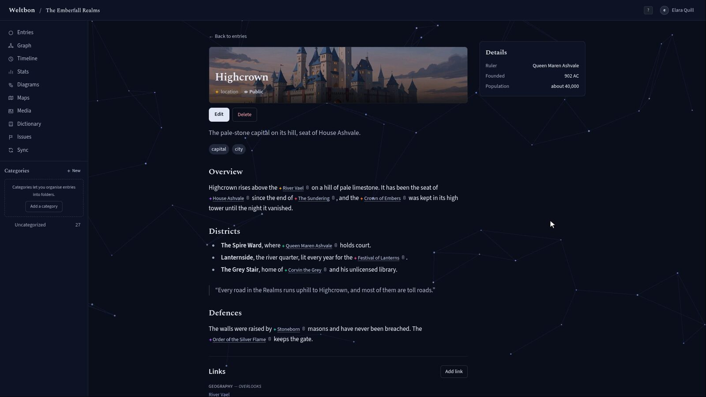
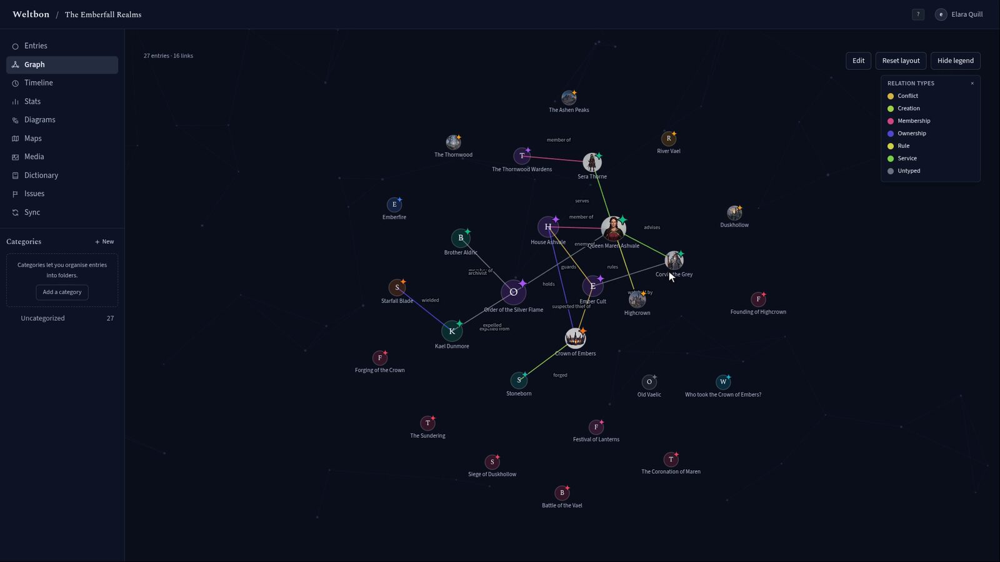
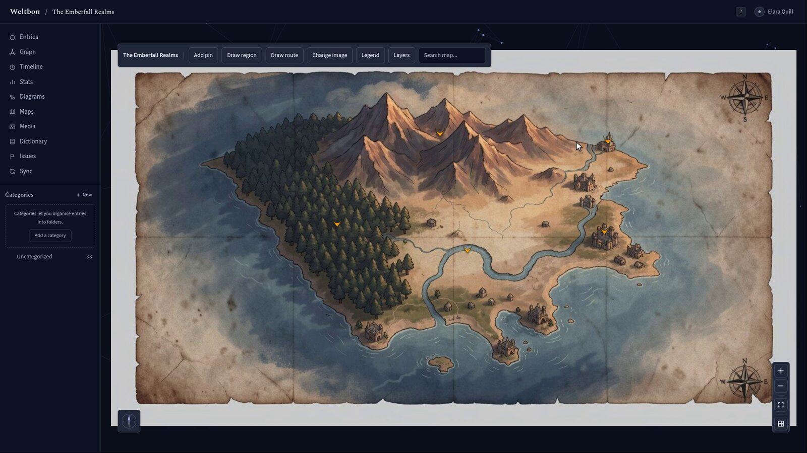
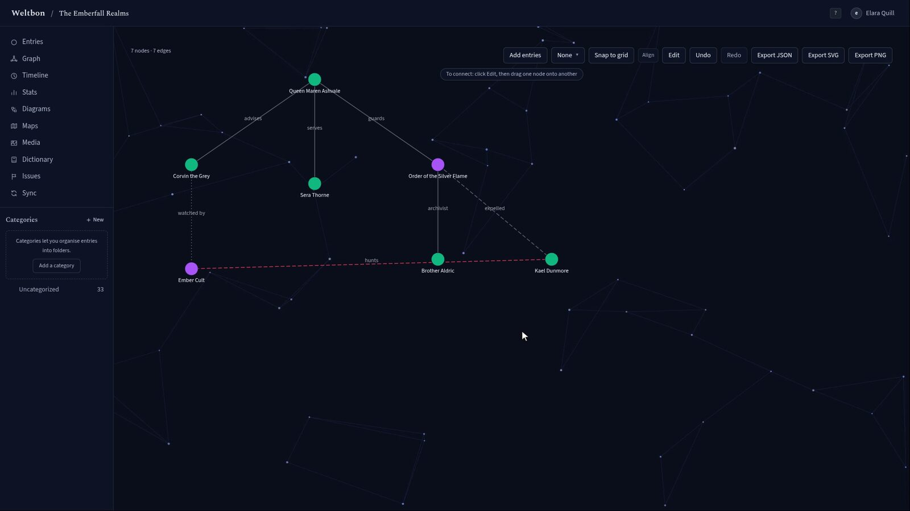

# Weltbon

Weltbon is a self-hosted workspace for worldbuilding. Write entries for the people, places and events of your setting, link them to one another, and explore how it all connects in a graph, on a timeline and on your own maps. Run it on your own server with Docker, or use the desktop app on your computer.



## Features

- **Entries** for characters, places, events, factions and anything else, written in Markdown with a live preview. Type `[[` to link another entry.
- **Links and backlinks** between entries, with relationship labels such as *rules*, *serves* or *enemy of*.
- **Graph** of every entry and how they connect.
- **Timeline** with your own calendar and eras.
- **Maps**: upload a map image and pin entries to it.
- **Diagrams** for family trees, courts and org charts.
- **Dictionary** for your constructed languages, plus stats and an issue tracker for loose ends.
- **Import** from Markdown, plain text, Word (`.docx`) or an Obsidian-style vault ZIP; **export** to Markdown, JSON, Word or PDF.
- **Sync** between the desktop app and a self-hosted server.

| Graph | Map | Diagram |
| --- | --- | --- |
|  |  |  |

## Desktop app

Download the desktop app from [GitHub Releases](https://github.com/Yalton/Weltbon/releases/latest):

- **Linux:** `Weltbon-<version>.AppImage`, or `weltbon-desktop_<version>_amd64.deb` for Debian and Ubuntu.
- **Windows:** `Weltbon.Setup.<version>.exe`.

macOS builds are not published yet; build from source as described in [Desktop app](docs/desktop-app.md). The desktop app keeps your universes on your computer and can sync with a self-hosted server.

## Self-Host (Docker)

Docker Compose is the recommended way to run Weltbon. It starts the API and PostgreSQL, keeps uploads and database data in named volumes, and includes Chromium for PDF export.

### Prerequisites

- Docker Engine and Docker Compose v2.
- Git.
- `openssl` to generate secrets.

### `.env` Reference

Copy `.env.example` to `.env` and replace the example credentials. Paste generated secrets literally; do not include shell substitutions or quotes.

| Variable | Requirement and meaning |
| --- | --- |
| `JWT_SECRET` | Required. At least 32 characters; use `openssl rand -hex 32`. |
| `POSTGRES_PASSWORD` | Required. Database password; use the same password in `DATABASE_URL`. |
| `DATABASE_URL` | Required. Compose uses `postgresql://weltbon:<password>@db:5432/weltbon`; `db` is the service name. |
| `INVITE_CODE` | Optional. Seeds the first invite only when the invite table is empty. If set, it must be at least 16 characters. Unset it to disable boot-time seeding. Create later invites with `docker compose exec app node dist/scripts/invite-new.js`. |
| `LLM_KEY_ENCRYPTION_KEY` | Required after saved LLM keys exist; a 32-byte hex key from `openssl rand -hex 32`. Back it up separately: losing it makes stored keys unreadable. |
| `SHARED_LLM_MONTHLY_COST_USD` | Optional. Shared hosted-LLM budget per recipient for the current UTC calendar month. Defaults to 1.00 USD; must be a finite positive number. |
| `PORT` | Optional API port inside the container; defaults to 3000. Compose publishes host port 3000. |
| `WELTBON_PUBLIC_ORIGIN` | Optional public origin (`https://host[:port]`) for the CORS allow-list behind a reverse proxy. When unset, CORS reflects origins; configure it for production. |

`CHROMIUM_PATH` is set to `/usr/bin/chromium` in the Docker image and normally needs no override.

### Quickstart

```bash
git clone https://github.com/Yalton/Weltbon.git
cd Weltbon
cp .env.example .env
```

Set `JWT_SECRET` with `openssl rand -hex 32`, choose a strong `POSTGRES_PASSWORD` and put it in both `POSTGRES_PASSWORD` and `DATABASE_URL`, then set an `INVITE_CODE` of at least 16 characters for the first account. Keep `.env` private. Set `LLM_KEY_ENCRYPTION_KEY` to a separate generated key before saving LLM keys.

```bash
docker compose up --build -d
```

The API applies database migrations at startup. To build with version and commit information and verify the deployed build, use `./scripts/deploy.sh` from the checkout (it pulls `origin master` by default); use `./scripts/deploy.sh --no-pull` to deploy the checked-out tree.

### Verifying

```bash
curl -fsS http://localhost:3000/health
docker compose ps
docker compose logs --tail=50 app
```

Open `http://localhost:3000/register` and register with the invite code. The health endpoint should return `{"ok":true}`. `GET /api/version` reports the running build identity.

### Updating

Back up first (see [Backup](#backup)), then update the checkout and deploy:

```bash
git pull --ff-only origin master
./scripts/deploy.sh --no-pull
```

The deploy script makes a PostgreSQL dump before migrations when the database container exists, builds the app, restarts it, and checks `/api/version`. Review `docker compose logs --tail=50 app` if deployment fails. Each release also publishes a container image, `ghcr.io/yalton/weltbon:<version>`. To use it instead of building locally, set `image: ghcr.io/yalton/weltbon:<version>` on the `docker-compose.yml` app service (there is a commented example) and remove its `build:` section.

## Backup

#### What to back up

- PostgreSQL data, including accounts, worldbuilding content, configuration, and stored encrypted LLM keys.
- The `uploads` volume, which contains uploaded files.
- `.env`, stored securely and separately. It includes database credentials, `JWT_SECRET`, and (if configured) `LLM_KEY_ENCRYPTION_KEY`. Back up the encryption key separately as well.

A SQL dump can be restored into a PostgreSQL instance with the matching database and user. Preserve the uploads volume and `.env` from the same backup point. Take and retain a backup before deploying migrations.

#### Scheduled PostgreSQL dump

For example, create a daily compressed dump at 02:15 UTC. Add both lines to the crontab. Bash's `pipefail` makes a failed `pg_dump` fail the job; the temporary archive is published only after the whole pipeline succeeds. In crontab, escape `%` as `\%` so cron passes it to `date`:

```cron
SHELL=/bin/bash
15 2 * * * set -o pipefail; cd /path/to/Weltbon && mkdir -p backups && tmp=$(mktemp backups/.weltbon-XXXXXX) && { docker compose exec -T db pg_dump -U weltbon -d weltbon | gzip > "$tmp"; } && mv -- "$tmp" "backups/weltbon-$(date -u +\%F).sql.gz" || { rm -f "$tmp"; exit 1; }
```

Check that the backup directory is writable and periodically test a restore. Keep copies outside the host running Weltbon.

#### What NOT to commit

Do not commit `.env`, database dumps, or backup archives. They contain credentials or private user data. Keep backups access-controlled.

## Self-Host (Bare Node)

For development or operators who manage PostgreSQL and Node themselves, install the system Chromium browser and configure its executable path. Docker already includes Chromium.

### Debian

```bash
sudo apt-get update
sudo apt-get install -y chromium
```

On Debian releases where the package is named `chromium` this installs Chromium from the configured Debian repositories.

### Ubuntu

```bash
sudo apt-get update
sudo apt-get install -y chromium-browser
```

Ubuntu may provide Chromium as a Snap package; ensure the installed browser can run for the service account.

### macOS

Install Chromium (for example with Homebrew) using `brew install --cask chromium`. Set `CHROMIUM_PATH` to the installed Chromium executable, commonly `/Applications/Chromium.app/Contents/MacOS/Chromium`.

### Windows

Install Google Chrome or Chromium and set `CHROMIUM_PATH` to its executable, for example `C:\\Program Files\\Google\\Chrome\\Application\\chrome.exe`. Run the API in an environment where that path is accessible.

After installing the repository's dependencies and configuring `DATABASE_URL` and `JWT_SECRET`, set `CHROMIUM_PATH` to the browser executable and run the API from `api/` with `pnpm dev` (which loads `../.env`). For a production build from the repository root, use Node 22 and pnpm 9:

```bash
pnpm install --frozen-lockfile
pnpm --filter @weltbon/api exec tsc -p tsconfig.build.json
pnpm --filter @weltbon/web build
cd api
DRIZZLE_DIR=./drizzle WELTBON_WEB_DIST=../web/dist node --env-file=../.env dist/index.js
```

The API applies migrations during startup. Keep `api/` as the working directory so the migration files and API assets resolve correctly. The web build is served from `../web/dist`; configure `CHROMIUM_PATH` in `.env` for PDF export.

### Troubleshooting

- If PDF export cannot launch a browser, confirm `CHROMIUM_PATH` points to an executable Chromium or Chrome binary and that the API user can execute it.
- If browser launch fails under a restricted service account or container, check that the account has access to required shared libraries and fonts.
- Verify the path in the actual service environment; interactive shell paths may differ from systemd or other process managers.

### Environment Variables

The following optional variables affect non-Docker or production deployments:

| Variable | Description |
| --- | --- |
| `SHARED_LLM_MONTHLY_COST_USD` | Optional per-recipient shared hosted-LLM budget for the current UTC month. Defaults to 1.00 USD and must be a finite positive number. |
| `WELTBON_PUBLIC_ORIGIN` | Public origin used to restrict CORS when running behind a reverse proxy. |
| `CHROMIUM_PATH` | Chromium or Chrome executable path used for PDF export; set this for bare-Node runs. |
| `LLM_KEY_ENCRYPTION_KEY` | 32-byte hex key needed to read/write saved LLM keys; losing it makes existing stored keys unreadable. |

At startup, invalid shared LLM budget configuration stops the API with `"SHARED_LLM_MONTHLY_COST_USD must be a finite positive number"`.

### Shared LLM Connections

SHARED_LLM_MONTHLY_COST_USD controls the per-recipient shared hosted-LLM
budget for the current UTC calendar month. It defaults to 1.00 USD and must
be a finite positive number. Shared connections support Anthropic and OpenAI
API keys only; Ollama connections remain private to the desktop instance.
Administrators must explicitly grant a user access, and that user must accept
the provider disclosure before content can leave the instance.

Set `LLM_KEY_ENCRYPTION_KEY` to a separate value generated with `openssl rand -hex 32` before saving or using stored provider keys. Back it up securely; losing it makes every stored LLM key unreadable.

## More

- [Desktop app](docs/desktop-app.md)
- [HTTPS reverse proxy](docs/reverse-proxy/README.md)
- [License](LICENSE)
